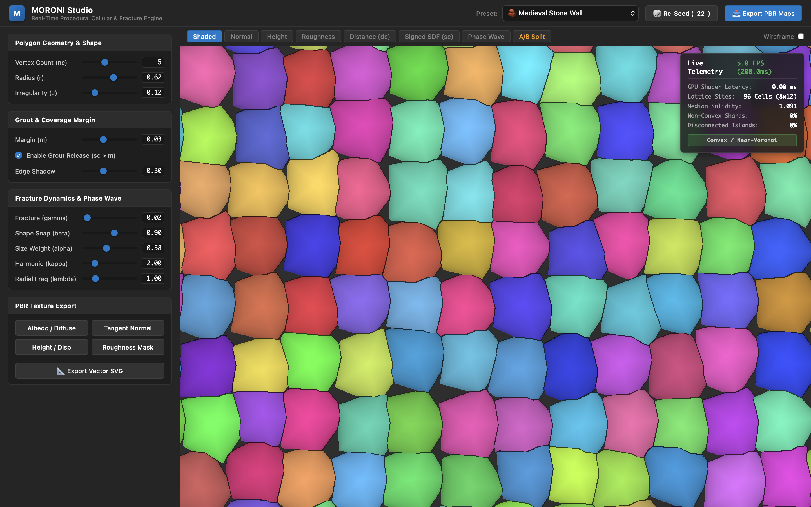
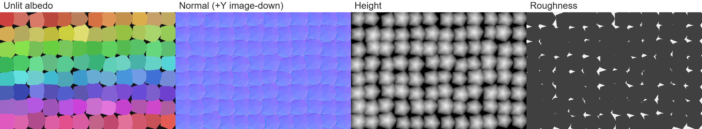
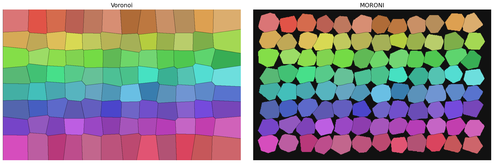
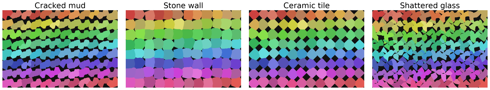

# MORONI: Polygon-Guided Cellular Textures via Roots-of-Unity Polygons and Phase-Modulated Boundaries

A real-time, art-directable replacement for Voronoi tessellation designed for procedural texturing, game engines, and physical rendering pipelines.

- **Interactive WebGL2 Studio:** [https://pikachuxxxx.github.io/Moroni-Studio/](https://pikachuxxxx.github.io/Moroni-Studio/)
- **Manuscript (PDF):** [paper/paper.pdf](paper/paper.pdf) (*Prepared for Journal of Computer Graphics Techniques (JCGT)*)

---

## Overview

Classical Voronoi diagrams use Euclidean perpendicular bisectors between point sites. While fast, they offer limited art direction:
1. **No Target Shape Steering:** Point sites cannot directly prescribe target polygon silhouettes (triangles, quads).
2. **Rigid Boundaries:** Boundaries are straight line segments, making it impossible to produce organic crack propagation, brittle fractures, or controlled mortar/grout channels.

MORONI replaces point sites with parameterized root-of-unity polygons evaluated through a three-term energy function:

$$E_c(\mathbf{x}) = \alpha \cdot d_c(\mathbf{x}) + \beta \cdot s_c(\mathbf{x}) + \gamma \cdot \bigl(1 - \cos(\kappa \theta_c(\mathbf{x}) + \lambda d_c(\mathbf{x}))\bigr)$$

where:
- $d_c(\mathbf{x})$ is the Euclidean distance to the cell center (governs overall cell size).
- $s_c(\mathbf{x})$ is the **signed** distance to the cell polygon (negative inside, pulling boundaries toward the target shape).
- The cosine wave modulates boundary curvature based on polar angle $\theta_c$ and radial distance, creating controllable crack patterns.
- An independent coverage margin $m$ releases non-tiling space into mortar ($s_{c^\star}(\mathbf{x}) > m$), freeing cells from the strict space-filling constraint and boosting polygon shape IoU from 0.49 to 0.89.



---

## Quickstart

### Python

```bash
pip install -r requirements.txt
```

```python
import moroni as M

# 1. Define cell lattice with target polygon shape (e.g. 5-sided masonry)
cells = M.make_cells(sides=(5, 6), radius=0.62, jitter=0.12, seed=42)
xv, yv = M.grid(1280, 720, cells.bbox)

# 2. Render with exact binned acceleration
renderer = M.BinnedRenderer(cells, beta=0.90)
raw = renderer.render(xv, yv, beta=0.90, gamma=0.02)

# 3. Apply coverage margin for 3% mortar width
labels = M.apply_margin(raw, cells, xv, yv, margin=0.03)

# 4. Colorize and save
img = M.colorize(labels.clip(0))
img[labels < 0] = [0.12, 0.12, 0.12]  # mortar color
```

### WebGL2 Shader

For real-time evaluation in fragment shaders, MORONI evaluates at 60+ FPS (<0.8 ms at 1080p). The complete GLSL implementation is available in `app/moroni-glsl.js`.

---

## 4-Channel PBR Map Generation

MORONI natively derives surface derivatives and signed interior heights for deferred rendering pipelines:



- **Albedo / Diffuse:** Cell identity colorization with edge shadow darkening.
- **Tangent Normal:** Surface normal vectors derived via central finite differences on the interior SDF.
- **Height / Displacement:** Parabolic dome profile derived from interior distance.
- **Roughness:** Independent mask separating smooth cell bodies from recessed mortar.

---

## Comparison with Voronoi and Weighted Diagrams



Power diagrams (Laguerre) are provably convex (0% non-convex cells). Apollonius diagrams are provably connected (0% disconnected islands). MORONI generates up to 95.8% non-convex shards and controlled disconnected island lobes, placing it outside the affine Voronoi family.

| Property | Standard Voronoi | Power Diagram | Apollonius | MORONI |
|---|---|---|---|---|
| Primitive | Point sites | Weighted points | Weighted points | Polygon cells |
| Shape Steering | Bisector only | Bisector only | Hyperbolas | Target polygons ($n=3..8$) |
| Grout / Mortar | None | None | None | Controllable margin $m$ |
| Fractures | Straight bisectors | Straight bisectors | Smooth curves | Phase wave interference |
| Non-Convex Cells | 0% | 0% | ~29% | Up to 100% |
| Disconnected Lobes | 0% | 0% | 0% | Controllable (0–10%) |
| GPU Fragment Cost | <0.5 ms | <0.7 ms | ~0.8 ms | 0.78 ms (1280 FPS @ 1080p) |

---

## Production Presets

The included presets cover a wide range of natural and synthetic materials:

| Preset | Sides ($n_c$) | Radius ($r$) | Jitter ($J$) | Margin ($m$) | $\alpha$ | $\beta$ | $\gamma$ | $\kappa$ | Description |
|---|---|---|---|---|---|---|---|---|---|
| **Stone Wall** | 5 | 0.62 | 0.12 | 0.03 | 0.58 | 0.90 | 0.02 | 2.0 | Masonry ashlar blocks with mortar recesses |
| **Cracked Mud** | 7 | 0.60 | 0.40 | 0.05 | 0.58 | 0.32 | 0.30 | 2.0 | Irregular desiccation crack network |
| **Ceramic Tile** | 4 | 0.60 | 0.02 | 0.01 | 0.58 | 1.20 | 0.00 | 2.0 | Quadrilateral floor tiles with thin grout |
| **Shattered Glass** | 4 | 0.70 | 0.50 | 0.08 | 0.58 | 0.32 | 0.35 | 3.0 | Acute triangular shards with stress cracks |
| **Spiderweb** | 6 | 0.65 | 0.30 | 0.04 | 0.50 | 0.35 | 0.42 | 4.0 | Radial impact fracture with harmonic rings |
| **Cobblestone** | 6 | 0.64 | 0.25 | 0.06 | 0.55 | 0.75 | 0.05 | 2.0 | Rounded paving stones with dirt channels |
| **Sci-Fi Hex** | 6 | 0.60 | 0.00 | 0.02 | 0.58 | 1.35 | 0.00 | 2.0 | Honeycomb armor plating with metallic seams |
| **Craquelure** | 5 | 0.55 | 0.35 | 0.015 | 0.60 | 0.40 | 0.22 | 2.0 | Fine micro-fissuring glaze on porcelain |
| **Dragon Scales** | 5 | 0.68 | 0.18 | 0.02 | 0.52 | 0.85 | 0.08 | 1.0 | Overlapping reptilian epidermal scutes |
| **Alien Biomass** | 6 | 0.62 | 0.45 | 0.04 | 0.48 | 0.45 | 0.28 | 3.0 | Organic cellular tissue with undulating seams |
| **Basalt Columns** | 6 | 0.60 | 0.08 | 0.012 | 0.58 | 1.10 | 0.00 | 2.0 | Volcanic cooling columnar jointing |
| **Voronoi Baseline** | 6 | 0.55 | 0.00 | 0.00 | 1.00 | 0.00 | 0.00 | 2.0 | Nearest-site Euclidean perpendicular bisectors |



---

## Repository Structure

```
├── app/                  # WebGL2 interactive texture generator & shaders
│   ├── index.html        # Clean studio interface
│   ├── style.css         # Dark theme styling
│   ├── app.js            # Controller and preset definitions
│   ├── moroni-glsl.js    # Fragment shader implementation
│   └── moroni-core.js    # CPU fallback & math routines
├── benchmarks/           # Verification suite, baselines, and profiling
│   ├── experiments.py    # Correctness and timing benchmarks
│   ├── lut_and_baselines_eval.py # Eikonal error analysis & baselines
│   ├── generate_pbr_figure.py    # PBR map generation script
│   └── results/          # JSON benchmark results
├── paper/                # ACM manuscript
│   ├── paper.tex         # LaTeX source
│   ├── paper.pdf         # Compiled manuscript PDF (12 pages)
│   ├── references.bib    # Validated bibliography
│   └── figures/          # Publication figures
├── prototypes/           # Initial research scripts and exploratory devlogs
├── src/                  # Core Python implementation
│   └── moroni.py
├── moroni.py             # Top-level import wrapper
├── requirements.txt      # Python dependencies
└── README.md
```

---

## Running Benchmarks & Building the Paper

```bash
# Set up environment
python3 -m venv .venv
source .venv/bin/activate
pip install -r requirements.txt

# Run correctness verification and timing benchmarks
MPLCONFIGDIR=/tmp python3 benchmarks/experiments.py all

# Run LUT discretization error analysis and baseline comparisons
MPLCONFIGDIR=/tmp python3 benchmarks/lut_and_baselines_eval.py

# Recompile the paper PDF
cd paper
pdflatex -interaction=nonstopmode paper.tex
bibtex paper
pdflatex -interaction=nonstopmode paper.tex
pdflatex -interaction=nonstopmode paper.tex
```

---

## Citation

```bibtex
@article{phani2026moroni,
  title   = {MORONI: Polygon-Guided Cellular Textures via Roots-of-Unity Polygons and Phase-Modulated Boundaries},
  author  = {Phani},
  journal = {Journal of Computer Graphics Techniques (JCGT)},
  year    = {2026}
}
```

