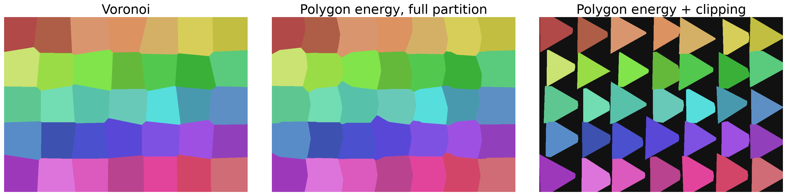

# MORONI: Polygon-Guided Cellular Textures via Roots-of-Unity Polygons and Phase-Modulated Boundaries

A finite cellular texture recipe that combines center distance, polygon signed distance, and angular phase. A coverage threshold releases background space after assignment. This is a stylization tool, not a physical fracture model.

- [Studio](https://pikachuxxxx.github.io/Moroni-Studio/) (the published site updates only when these changes are deployed)
- [Revised manuscript](paper/paper.pdf) and [LaTeX source](paper/paper.tex)
- [Reproduction instructions](REPRODUCIBILITY.md) and [review resolutions](REVIEW_RESOLUTION.txt)



## What the measurements support

With eight seeds, triangle targets and matched clipping, mean target IoU is 0.939 for clipped Voronoi and 0.954 for MORONI with phase disabled. Clipping supplies most of the shape fidelity. Phase changes boundaries and can reduce fidelity. This modest benefit is reported without claiming a new weighted-diagram family or universal superiority.

The accelerated and full CPU searches agree on 737,280 tested pixels across 120 analytical/hybrid cases. Nine browser cases show no GPU pruned/full differences on 55,296 pixels; CPU/GPU precision differs at one nearly tied pixel. These are finite tests, not exhaustive floating-point guarantees.

Timing tables come from saved samples on one Windows machine. GPU timing uses disjoint timer queries and excludes JavaScript, upload, readback and encoding. See the paper and raw JSON for hardware, settings, timings and limitations. No universal FPS or cross-device performance claim is made.

## Run locally

From the repository root:

```text
python -m http.server 8765 --bind 127.0.0.1
```

Open http://127.0.0.1:8765/app/ . No JavaScript build step or package installation is needed. WebGL2 is the primary implementation. The default Paper Colors view and albedo PNG use the same unlit palette as the paper. There is no shaded mode. Exports preserve the lattice aspect ratio. SVG exports the input polygons, not assigned-cell contours.

## Python example

```python
import moroni as M
from PIL import Image
import numpy as np

field = M.make_cells(sides=5, radius=.62, jitter=.12, seed=22)
x, y = M.grid(640, 400, field.bbox)
labels = M.render_binned(field, x, y, beta=.90, gamma=.02, analytic=True)
labels = M.apply_margin(labels, field, x, y, margin=.03, analytic=True)
rgb = M.colorize(labels, n_cells=field.n)
Image.fromarray(np.round(255*rgb).astype('uint8')).save('moroni.png')
```

Install `requirements.txt` first. The margin is a world-distance threshold, not a percentage or guaranteed mortar width. The default Python distance mode is a hybrid LUT approximation; `analytic=True` selects analytical polygon distance. Candidate pruning applies to the chosen distance function. Query grids and bounds are recomputed for each render.


## Scope and artifact layout

- `src/moroni.py`: canonical CPU implementation, conservative adaptive search and metrics.
- `app/`: shared geometry, WebGL2 renderer, studio and validation page.
- `tests/`: regression tests and Python/JavaScript fixture.
- `benchmarks/reproduce.py`: authoritative CPU experiment and figure pipeline.
- `benchmarks/results/`: current raw measurements; obsolete results were removed.
- `paper/`: original two-column manuscript structure, refreshed figures and `references.bib`. Tables stay inline in `paper.tex`; there are no generated TeX fragments.
- `prototypes/`: historical standalone explorations, not the supported implementation or evidence for current claims.

Limitations include finite nonperiodic fields, coupled controls, near-tie precision sensitivity, modest filtering, illustrative map parameters and GPU validation on one device. Height and normal maps are not measured material properties. The CPU fallback uses raster normal differences and does not reproduce the GPU diagnostic views. Current tests do not establish mobile compatibility, physical realism or artist preference.

## Citation

This is an unpublished manuscript; JCGT acceptance has not been established.

```bibtex
@misc{srikar2026moroni,
  title = {MORONI: Polygon-Guided Cellular Textures via Roots-of-Unity Polygons and Phase-Modulated Boundaries},
  author = {Srikar, Phani},
  year = {2026},
  note = {Unpublished manuscript and software artifact},
  howpublished = {\url{https://github.com/Pikachuxxxx/Moroni-Studio}}
}
```

Code is MIT licensed. Follow [REPRODUCIBILITY.md](REPRODUCIBILITY.md) to rerun tests, regenerate figures/tables and compile the paper.
